# 07 · Diagramas — El proyecto en imágenes

> Todos los diagramas están escritos en [Mermaid](https://mermaid.js.org/): GitHub los dibuja solos y se editan como texto. Leyenda: **[D]** decidido · **[P]** propuesta · **[?]** abierto.

Índice:
1. [Cronología real del Datathon (Gantt)](#1-cronología-real-del-datathon-gantt)
2. [Hoja de ruta propuesta tras el Datathon (Gantt) [P]](#2-hoja-de-ruta-propuesta-tras-el-datathon-gantt-p)
3. [Arquitectura del prototipo](#3-arquitectura-del-prototipo)
4. [Dónde vive cada dato (privacidad)](#4-dónde-vive-cada-dato-privacidad)
5. [Recorrido de la persona por las pantallas](#5-recorrido-de-la-persona-por-las-pantallas)
6. [Secuencia: subir la citación](#6-secuencia-subir-la-citación)
7. [Secuencia: enlace del abogado/a](#7-secuencia-enlace-del-abogadoa)
8. [Modelo de datos (SQLite)](#8-modelo-de-datos-sqlite)
9. [Ramas y despliegue: local y online](#9-ramas-y-despliegue-local-y-online)
10. [Integración continua](#10-integración-continua)
11. [Mapa de la documentación](#11-mapa-de-la-documentación)

---

## 1. Cronología real del Datathon (Gantt)
Reconstruida a partir de los commits del repositorio (hora local). Cada barra agrupa los commits de una misma línea de trabajo.

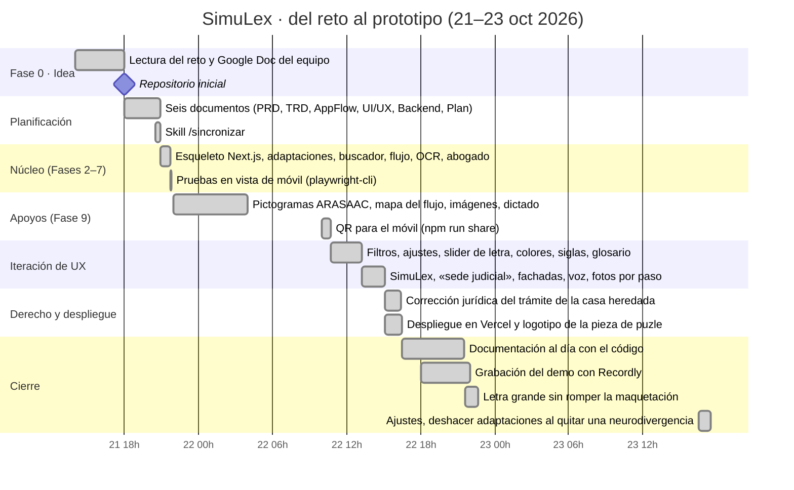

> Las horas de inicio de «Lectura del reto», «Apoyos» y «Grabación» son aproximadas: solo se conoce la hora del commit en que terminaron.

## 2. Hoja de ruta propuesta tras el Datathon (Gantt) [P]
Propuesta para debatir en el equipo. **Las fechas son orientativas** (se cuentan desde que se acuerde empezar) y dependen del equipo y de los permisos. Detalle de cada bloque en [09 · Stack ideal](09-Stack-ideal-produccion.md) y [10 · Escalabilidad](10-Escalabilidad-rendimiento-recursos.md).

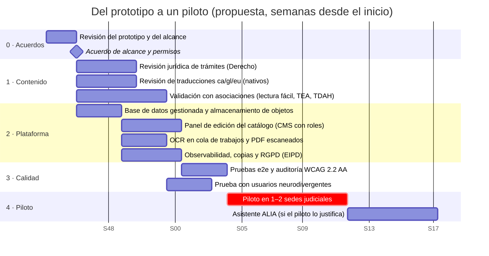

## 3. Arquitectura del prototipo
Una sola aplicación Next.js sirve las pantallas y la API. No hay servicios externos en tiempo de ejecución (salvo la primera descarga de los modelos del OCR).

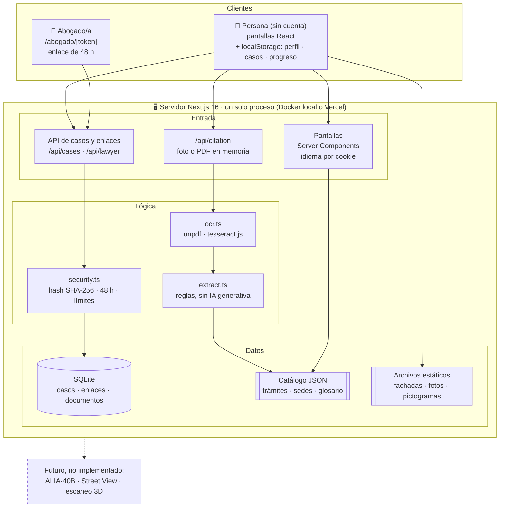

## 4. Dónde vive cada dato (privacidad)
El dato más sensible (las adaptaciones, que pueden revelar una neurodivergencia) **nunca sale del dispositivo**. La citación se procesa en memoria y se borra.

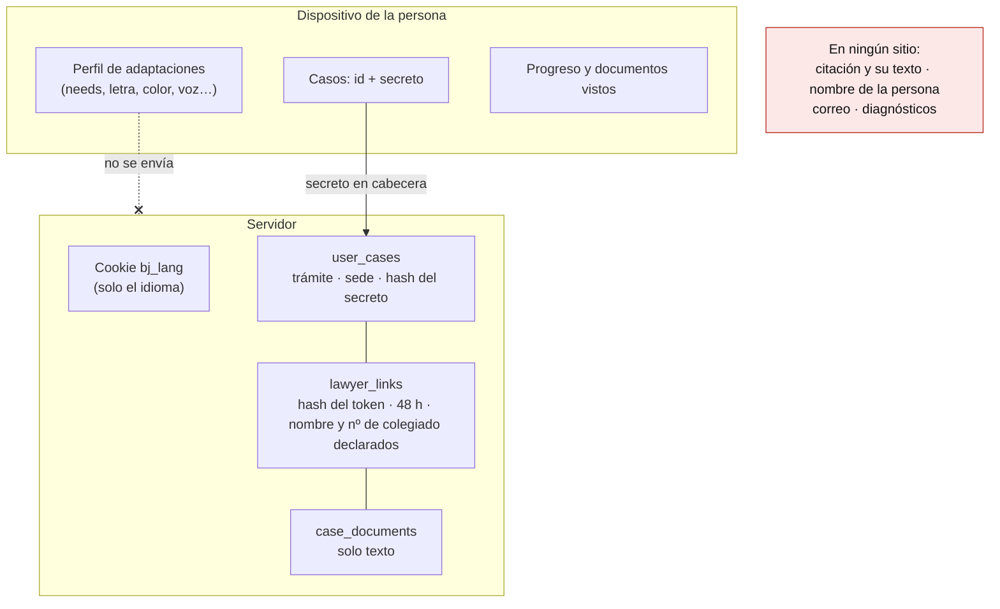

## 5. Recorrido de la persona por las pantallas

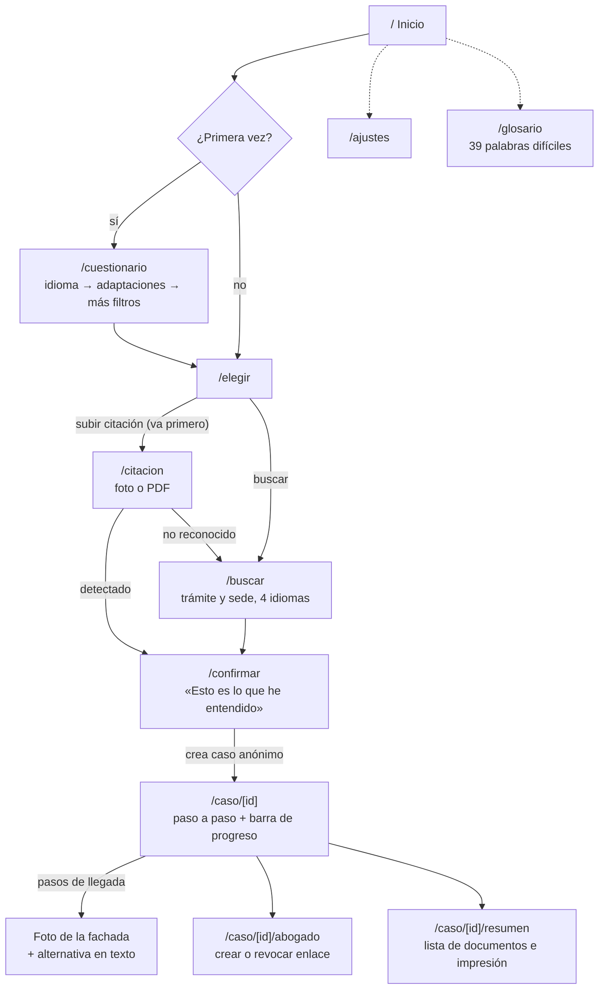

## 6. Secuencia: subir la citación

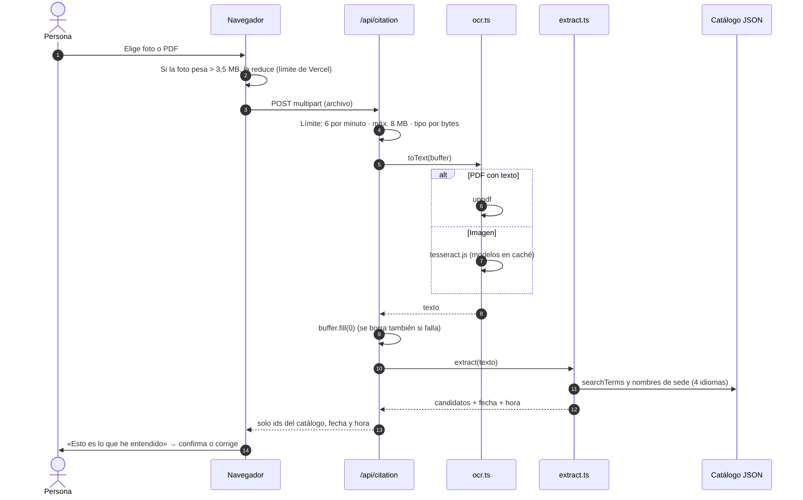

## 7. Secuencia: enlace del abogado/a

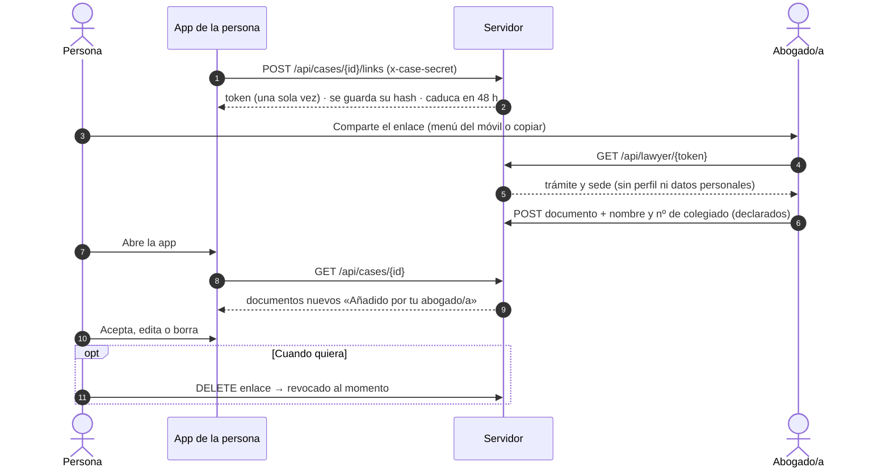

## 8. Modelo de datos (SQLite)
`procedure_id` y `court_id` apuntan a ids del catálogo JSON (no hay clave foránea). Detalle en [05 · Backend Schema](05-Backend-Schema.md).

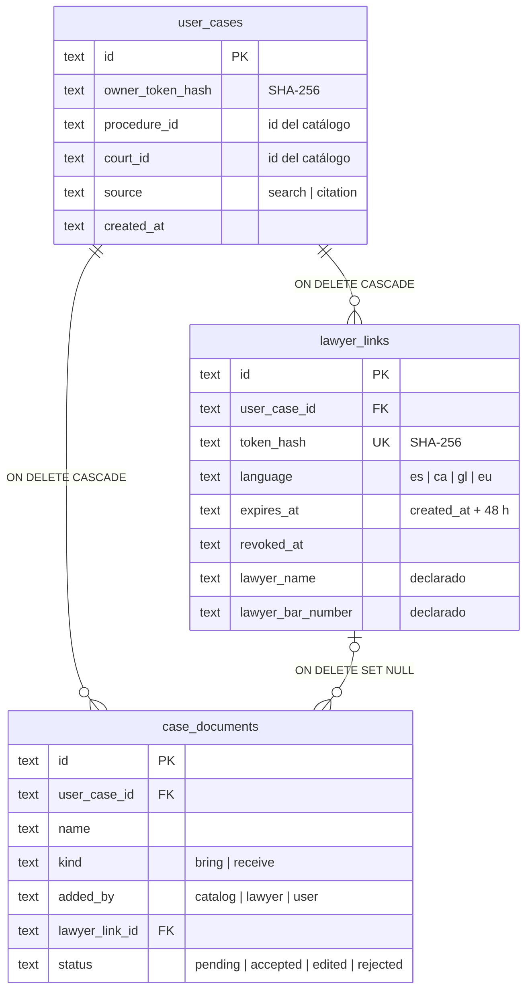

## 9. Ramas y despliegue: local y online
`main` tiene el código común, la documentación y la CI. `local` y `online` solo añaden lo propio de cada forma de ejecutarlo. Los cambios de código entran siempre por `main`. Guía completa en [11 · Ramas y despliegue](11-Ramas-y-despliegue.md).

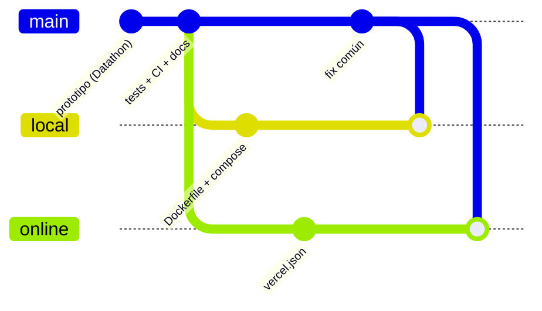

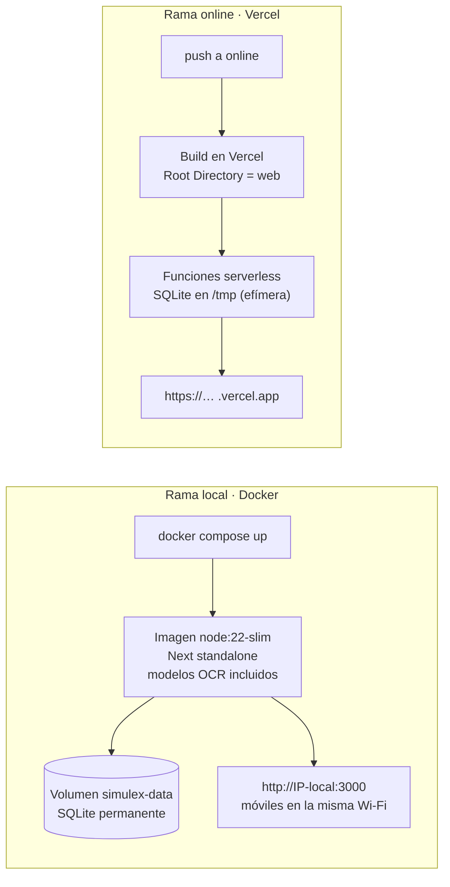

## 10. Integración continua
Los mismos workflows corren en las tres ramas. El trabajo de Docker solo se activa donde existe `web/Dockerfile` (rama `local`).

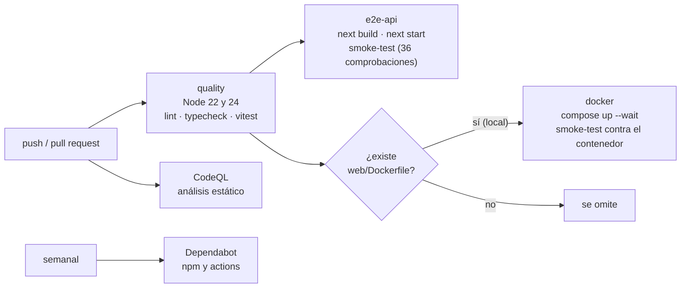

## 11. Mapa de la documentación

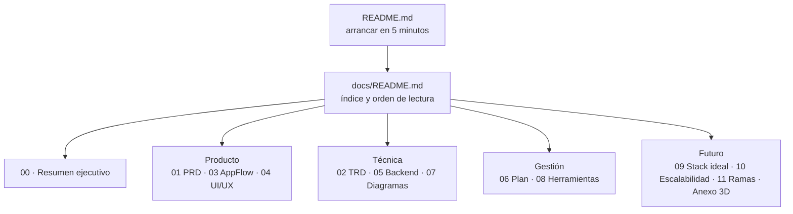
