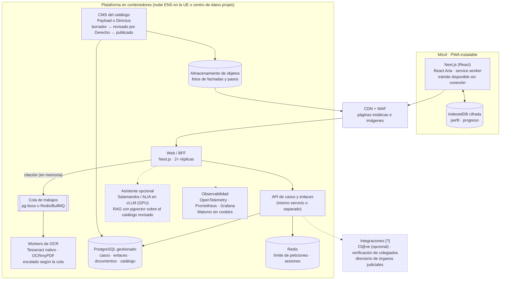

# 09 · Stack ideal para producción (si no fuera una demo)

> **Propuesta [P]** para debatir con Ineco y el equipo. No es una decisión. Parte de lo que hay en el prototipo ([02 · TRD](02-TRD.md)) y explica qué cambiaría para un servicio público real, por qué y en qué orden. Las cifras de rendimiento están en [10 · Escalabilidad](10-Escalabilidad-rendimiento-recursos.md).

## 1. Qué cambia al pasar de demo a servicio
El prototipo se diseñó para **una máquina, un día y datos sintéticos**. Un servicio para la Administración de Justicia tiene requisitos que el Datathon no pedía:

| Requisito | Por qué importa aquí | Norma o referencia |
|---|---|---|
| Accesibilidad obligatoria | Es un servicio público para personas neurodivergentes | RD 1112/2018 (accesibilidad de sitios web del sector público) → UNE-EN 301 549 → WCAG 2.1 AA; Ley 15/2022; RDL 1/2013 |
| Seguridad certificable | Sistema de la Administración que trata datos personales | Esquema Nacional de Seguridad, RD 311/2022 (categoría a determinar; previsiblemente MEDIA) |
| Protección de datos | La citación tiene datos personales y las adaptaciones pueden revelar datos de salud | RGPD (art. 9 para categorías especiales) y LO 3/2018. Hace falta una **evaluación de impacto (EIPD)** |
| Datos en la UE o en España | Soberanía y requisitos del ENS | Nube con certificación ENS o centro de datos propio |
| Contenido jurídico versionado | Un trámite mal explicado causa daño | Flujo de revisión por Derecho con historial |
| Cuatro idiomas revisados | Cooficialidad | Revisión por hablantes nativos y por Derecho |
| Disponibilidad | La persona lo consulta el día antes o en la puerta de la sede | Objetivo propuesto: 99,5 % y uso sin conexión del trámite ya abierto |

## 2. Principios
1. **Mantener lo que funciona:** la arquitectura del prototipo (perfil en el dispositivo, citación en memoria, catálogo revisado y sin IA generativa en el camino crítico) ya es *privacy by design*. Se conserva.
2. **Separar responsabilidades** que en la demo comparten proceso: web, OCR, contenido y (en el futuro) IA.
3. **Software libre y sin dependencia de un proveedor:** contenedores estándar, PostgreSQL y herramientas que la Administración pueda alojar.
4. **Accesibilidad verificable:** pruebas automáticas en cada cambio y pruebas con personas usuarias.

## 3. Arquitectura propuesta

## 4. Pieza por pieza

| Capa | Prototipo (hoy) | Producción (propuesta) | Por qué |
|---|---|---|---|
| **Framework web** | Next.js 16 + React 19 + TypeScript | **Se mantiene** | Funciona, el equipo lo conoce y permite renderizado estático |
| **Renderizado** | Todas las páginas dinámicas (la cookie de idioma se lee en el layout) | Páginas **estáticas por idioma** (`/es/…`, `/ca/…`) servidas desde CDN; solo la API es dinámica | Coste casi cero por visita y latencia mínima (ver [10 §3](10-Escalabilidad-rendimiento-recursos.md)) |
| **Componentes accesibles** | Componentes propios | **React Aria** (Adobe) como base, con el diseño propio encima | Patrones ARIA probados (foco, teclado, lectores de pantalla) en vez de mantenerlos a mano |
| **Uso sin conexión** | No | **PWA** con service worker: el trámite abierto, sus fotos y su lista de documentos se guardan en el móvil | En la sede puede no haber cobertura, y la persona necesita el paso siguiente justo ahí |
| **Datos en el dispositivo** | `localStorage` | **IndexedDB** + cifrado con Web Crypto, y exportación del perfil como código o QR para cambiar de móvil | Es dato sensible y hoy se pierde al borrar el navegador |
| **Idiomas** | Diccionarios TypeScript propios | **ICU MessageFormat** (`next-intl` o Lingui) + **Weblate** (libre, autoalojable) para traducir y revisar | Los revisores de ca/gl/eu trabajan sin tocar código; historial y estado de revisión por texto |
| **Catálogo** | JSON en el repositorio | **CMS headless** (Payload, integrado con Next.js, o Directus) sobre PostgreSQL, con roles (editor, revisor jurídico, traductor) y flujo **borrador → revisado → publicado** | Derecho edita sin Git; cada cambio legal queda firmado y fechado; se pueden añadir sedes y trámites a escala |
| **Base de datos** | SQLite (`node:sqlite`), un archivo | **PostgreSQL** gestionado (con réplica y copias), migraciones con Drizzle o Prisma | Varias réplicas de la web; en Vercel la SQLite en `/tmp` se pierde |
| **Límite de peticiones** | En memoria, por proceso | **Redis** (o el WAF) | Con varias réplicas el límite en memoria no protege |
| **OCR** | tesseract.js (WebAssembly) dentro de la petición | **Cola + workers**: Tesseract nativo o PaddleOCR, **OCRmyPDF** para PDF escaneados, preprocesado (enderezar, contraste) con OpenCV | El OCR es lo único que consume CPU; aislado no bloquea la web. Hoy no se leen PDF escaneados |
| **Extracción** | Reglas y palabras clave | Reglas + un **modelo pequeño de reconocimiento de entidades** (por ejemplo, de la familia RoBERTa del BSC/PlanTL), con un conjunto de evaluación etiquetado | Más aciertos con citaciones reales, sin generar texto |
| **IA conversacional** | No (ALIA-40B estudiado, no integrado) | **Opcional y detrás del núcleo:** Salamandra-7B o ALIA-40B en **vLLM** sobre GPU propia, RAG con **pgvector** solo sobre el catálogo revisado, con filtros y evaluación por idioma | Mismo criterio del TRD §2f: si falla, la app funciona igual |
| **Fachadas** | Foto fija de Wikimedia Commons | Fotos propias tomadas por el personal de cada sede y subidas al CMS | Derechos claros y la foto es de la puerta correcta. Street View no permite guardar sus imágenes |
| **Abogado/a** | Nombre y número de colegiado declarados | Verificación del número de colegiado con el censo del Consejo General de la Abogacía o con certificado ACA [?] | Hoy cualquiera puede decir que es abogado |
| **Identidad de la persona** | Sin cuenta | **Sigue sin cuenta por defecto**; cuenta opcional con **Cl@ve** solo para sincronizar entre dispositivos [?] | No pedir identidad para algo que no la necesita |
| **Imágenes** | WebP en `public/` | Almacenamiento de objetos + CDN, AVIF/WebP por tamaño de pantalla | Fotos de muchas sedes sin inflar el despliegue |
| **Observabilidad** | Ninguna | **OpenTelemetry** → Prometheus/Grafana; errores con Sentry autoalojado; analítica **Matomo** sin cookies y sin datos personales | Saber si funciona sin rastrear a nadie |
| **Seguridad** | Hash de secretos, límites, tipo por bytes | + WAF, cabeceras CSP y HSTS, gestor de secretos, **DAST con OWASP ZAP** en la CI, prueba de penetración antes del piloto, adecuación al ENS | Requisito para entrar en producción |
| **Accesibilidad (pruebas)** | Revisión manual y playwright-cli | **axe-core en las pruebas e2e de Playwright** en cada PR + auditoría manual con NVDA, VoiceOver y TalkBack + pruebas con personas neurodivergentes (con asociaciones) | La norma pide WCAG AA y el reto pide algo más: que se entienda |
| **Infraestructura** | Un portátil o Vercel | Contenedores en **Kubernetes** (o un servicio gestionado de contenedores) con **OpenTofu/Terraform**; entornos de desarrollo, preproducción y producción | Reproducible y portable entre nubes o al centro de datos de Justicia |
| **CI/CD** | GitHub Actions (tests, smoke, Docker, CodeQL) | Lo mismo + e2e con Playwright, DAST, firma de imágenes (cosign), SBOM y despliegue progresivo | Trazabilidad de lo que llega a producción |

## 5. Lo que **no** se recomienda
- **Pedir cuentas o diagnósticos** para usar la app: rompe la decisión de privacidad, que es una de sus fortalezas.
- **Generar pasos de un trámite con IA a partir de la citación:** el contenido tiene que salir siempre del catálogo revisado.
- **Enviar la citación a un OCR o una IA de terceros** fuera de la UE.
- **Microservicios desde el principio:** con la demanda prevista basta un servicio web, uno de OCR y la base de datos (ver [10](10-Escalabilidad-rendimiento-recursos.md)).

## 6. Orden recomendado
1. **PostgreSQL y Redis** (desbloquea varias réplicas y el enlace del abogado fiable).
2. **Páginas estáticas por idioma + CDN + PWA** (rendimiento y uso sin conexión).
3. **CMS con flujo de revisión jurídica + Weblate** (escalar el contenido, que es el verdadero cuello de botella).
4. **OCR en cola con PDF escaneados** y conjunto de evaluación con citaciones reales anonimizadas.
5. **Seguridad (ENS) y EIPD**, e2e con axe-core, pruebas con personas usuarias.
6. **Piloto en una o dos sedes**; después, si el piloto lo justifica, el asistente de IA y la experiencia 3D ([Anexo](Anexo-3D-Escaneo.md)).

La hoja de ruta en el tiempo está en [07 · Diagramas §2](07-Diagramas.md#2-hoja-de-ruta-propuesta-tras-el-datathon-gantt-p).
