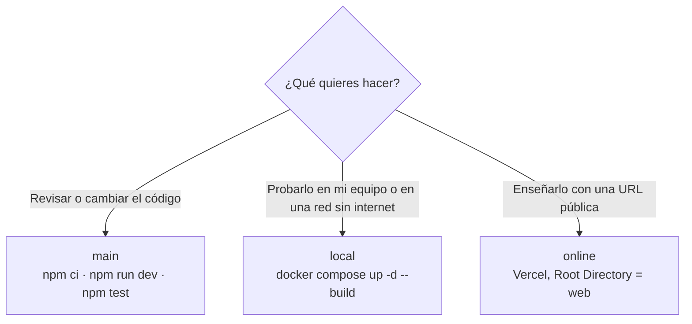

# 11 · Ramas y despliegue: versión local y versión online

> Cómo está organizado el repositorio para que cualquiera pueda **descargar y ejecutar** el prototipo (versión local) o **desplegarlo** en internet (versión online). Diagrama en [07 §9](07-Diagramas.md#9-ramas-y-despliegue-local-y-online).

## 1. Las tres ramas

| Rama | Qué contiene | Para quién |
|---|---|---|
| **`main`** | Código común, documentación, tests y CI. Se ejecuta con Node (`npm run dev`) | Quien revisa el código o lo desarrolla |
| **`local`** | `main` + **Docker**: `web/Dockerfile`, `web/.dockerignore` y `docker-compose.yml` | Quien quiere ejecutarlo en su equipo con un comando, sin instalar Node |
| **`online`** | `main` + **Vercel**: `web/vercel.json` | Quien quiere publicarlo en internet |

**Regla:** todo cambio de código o de documentación entra por `main` (con una rama de funcionalidad y un PR o `/sincronizar`). Después, `main` se mergea en `local` y en `online`. En `local` y `online` solo se toca lo propio de cada despliegue. Así las tres ramas no se separan.

```bash
# Llevar los cambios de main a las dos variantes
git switch local  && git merge main && git push
git switch online && git merge main && git push
git switch main
```

La CI (`.github/workflows/ci.yml`) corre en las tres ramas: lint, tipos, tests unitarios, build y smoke test. En `local` además construye la imagen Docker, la arranca y pasa el smoke test contra el contenedor.

## 2. Versión local (Docker)

### Requisitos
- [Docker Desktop](https://www.docker.com/products/docker-desktop/) (Windows o macOS) o Docker Engine + Compose (Linux).
- Internet **solo para construir la imagen**: después funciona sin conexión (los modelos del OCR van dentro).

### Arrancar
```bash
git clone -b local https://github.com/perezllanosnicolas/Datathon.git simulex
cd simulex
docker compose up -d --build      # primera vez: ~1–2 min
```
Abre http://localhost:3000.

### Desde el móvil
1. El móvil y el ordenador en la **misma Wi-Fi** (mejor una red propia, por ejemplo, el punto de acceso del móvil).
2. Busca la IP del ordenador (`ipconfig` en Windows, `ip a` en Linux, `ipconfig getifaddr en0` en macOS).
3. En el móvil: `http://<IP>:3000`. Si no carga, permite Docker en el cortafuegos (redes privadas).

### Otras órdenes
| Para | Orden |
|---|---|
| Ver si está sano | `docker compose ps` (columna `STATUS`: `healthy`) |
| Ver el registro | `docker compose logs -f` |
| Parar | `docker compose down` |
| Borrar también los casos guardados | `docker compose down -v` |
| Usar otro puerto | `SIMULEX_PORT=8080 docker compose up -d` |
| Probar la API | `cd web && node scripts/smoke-test.mjs http://localhost:3000` (Node 22+) |

### Cómo es la imagen
- Tres etapas (`deps` → `build` → `run`) sobre `node:22-bookworm-slim`. Next.js en modo **standalone** (`NEXT_OUTPUT=standalone`): solo se copia lo que el servidor necesita.
- Durante la compilación se ejecuta `npm run ocr:models`, que descarga los modelos de español, catalán, gallego y euskera (12 MB) dentro de la imagen.
- Se ejecuta como el usuario `node` (no root), con un *healthcheck* sobre `/`.
- La base de datos SQLite va en el volumen `simulex-data` (`/app/storage/app.db`): los casos y los enlaces del abogado **sobreviven a los reinicios**.
- Tamaño: ~490 MB. Memoria: ~55 MB en reposo y ~300 MB tras usar el OCR (ver [10](10-Escalabilidad-rendimiento-recursos.md)).

## 3. Versión online (Vercel)

### Desplegar
1. En [Vercel](https://vercel.com/): **Add New → Project** e importa el repositorio.
2. **Root Directory = `web`**. El framework (Next.js) se detecta solo. No hace falta ninguna variable de entorno.
3. **Production Branch = `online`** (Settings → Git). Cada push a `online` publica; los PR tienen una URL de vista previa.

`web/vercel.json` fija la región (`cdg1`, París, dentro de la UE) y la instalación con `npm ci`. Las cabeceras de seguridad (`Referrer-Policy`, `Permissions-Policy`…) están en `next.config.ts`, así que valen en las dos versiones.

### Límites que hay que conocer
| Límite | Efecto | Qué hacer |
|---|---|---|
| El disco solo se puede escribir en `/tmp` | La base de datos va en `/tmp/app.db`: **no es permanente ni se comparte entre instancias**. Un caso o un enlace del abogado puede desaparecer | Para la demo, hacer el recorrido completo sin reiniciar el despliegue. Para algo serio, PostgreSQL ([09](09-Stack-ideal-produccion.md)) |
| Cuerpo de la petición de 4,5 MB | Las fotos de más de 3,5 MB se reducen en el navegador; un PDF de más de 4,5 MB no se puede subir | — |
| Arranque en frío | Tras un rato sin uso, la primera citación descarga los modelos del OCR en `/tmp/tessdata` (unos segundos más) | Subir una citación de prueba antes de presentar |
| Límite de peticiones en memoria | Cada instancia lleva su propia cuenta | Aceptable para una demo |

Demo publicada: https://datathon-olive.vercel.app

## 4. Sin Docker ni Vercel (desarrollo)
Desde `main`, con **Node.js 22.13 o superior**:
```bash
cd web
npm ci
npm run dev                # http://localhost:3000
npm run share              # compila, arranca y muestra un QR para el móvil (misma Wi-Fi)
npm run ocr:models         # opcional: descarga los modelos del OCR para usarlo sin internet
```

## 5. Qué rama elegir


